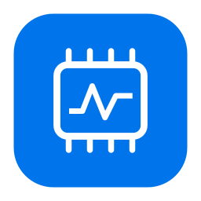
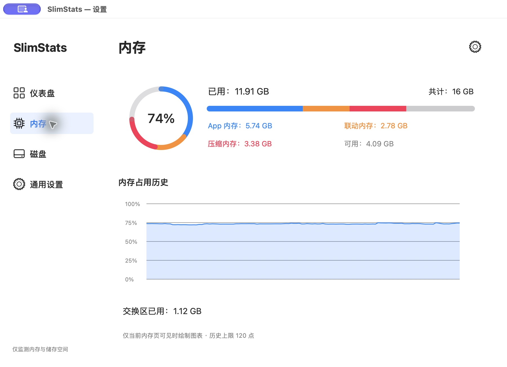
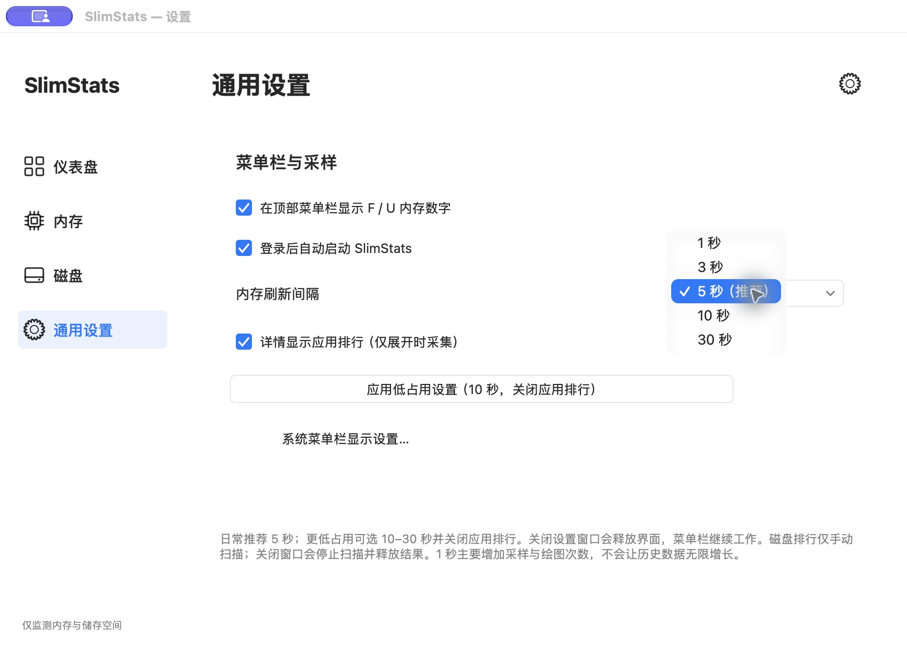
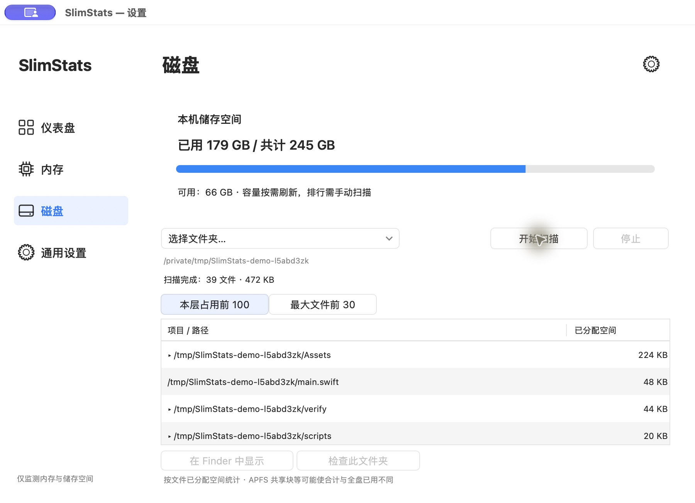

<p align="center">
  
</p>

# SlimStats

**专注内存与磁盘的轻量 macOS 菜单栏监测工具。原生 AppKit，按需采集，可自定义内存刷新频率。**

[English](README.en.md) · [安装与构建](#安装与构建) · [低占用设置](#如何选择刷新频率) · [资源开销说明](docs/PERFORMANCE.md) · [问题反馈](https://github.com/YouFangZeXian/SlimStats/issues)

SlimStats 适合只想随时看到 Mac 剩余内存、已用内存，并偶尔检查磁盘空间的人。它把功能集中在 **RAM 和储存空间**：没有 CPU、GPU、温度、风扇、网络或电池实时监测模块，不常驻 Dock，不在后台持续索引全盘。

> 低占用是项目的核心设计方向，并非固定内存用量保证。原生界面、系统缓存和目录扫描都会影响占用，目前尚未验证全部使用状态的 RSS 都低于 100 MB。详见[资源开销与测量方法](docs/PERFORMANCE.md)。

## 为什么选择 SlimStats

| 特点 | 使用体验 |
| --- | --- |
| 只关注内存与磁盘 | 减少不需要的实时监测模块，专注日常最常看的两项 |
| 菜单栏直接读数 | 两行 `F` / `U` 显示空闲与已用内存，数字右对齐，`GB` 单位固定对齐 |
| 可调内存刷新频率 | 1 / 3 / 5 / 10 / 30 秒可选，兼顾及时性和采样开销 |
| 按需加载 | 详情展开时才采集应用排行；关闭详情后停止后续采集并释放自有视图 |
| 一键低占用设置 | 10 秒内存采样并关闭应用排行，需要时再开启 |
| 原生且无第三方依赖 | Swift + AppKit，使用 macOS 系统 API，无需 WebView、Electron 或 SwiftUI |
| 本地工作 | 无需账号，无遥测；监测数据和磁盘扫描结果不会上传 |

## 界面预览

以下为实际安装的 SlimStats 1.3（build 11）在 2026-10-25 运行时的原始截图。读数仅展示界面，不代表固定内存占用或性能测试结果。

**内存页面：用量分类与最近的内存变化。**



<details>
<summary>查看刷新频率与低占用设置</summary>

可选 1 / 3 / 5 / 10 / 30 秒；一键低占用设置采用 10 秒采样并关闭应用排行。



</details>

<details>
<summary>查看磁盘空间检查</summary>

此图扫描的是公开项目源码的临时副本，展示按已分配空间排序的真实结果；不会展示个人文件，也不会删除文件。



</details>

## 功能

- **内存详情**：已用、可用、App、联动、压缩内存和交换区，附最近 120 个采样点的趋势。
- **应用与进程排行**：展开详情时显示前 8 项，按 RSS 降序排列；同一应用及其辅助进程合并统计。
- **关闭高占用应用**：点击图标显示 `×`，点击名称可取消选择；点击 `×` 后须再次确认。正常退出失败后会尝试强制退出，未保存内容可能丢失；受保护进程会显示限制原因。
- **磁盘容量**：查看总容量、已用及剩余空间。
- **手动空间检查**：选择用户文件夹、应用程序、数据卷或自选目录，查看本层占用前 100 项和范围内最大文件前 30 项；支持逐层检查和 Finder 定位，不提供文件删除功能。
- **设备仪表盘**：设备型号、系统、处理器、物理内存等本机概览；这是静态信息页，不会新增 CPU/GPU 实时采样模块。
- **通用设置**：内存刷新间隔、菜单栏显示、应用排行和登录后自动启动。

## 安装与构建

当前提供源码构建方式，尚无正式公证的安装包、Homebrew formula 或自动更新渠道。

**环境要求：Apple Silicon Mac、macOS 14 或更高版本、Xcode 命令行工具。** 当前构建脚本固定输出 `arm64`，未验证 Intel Mac。

如果没有命令行工具，先执行以下命令，并完成系统安装提示：

```sh
xcode-select --install
```

获取源码并构建：

```sh
git clone https://github.com/YouFangZeXian/SlimStats.git
cd SlimStats
./build.sh
open SlimStats.app
```

构建成功后，在 Finder 中把仓库里的 `SlimStats.app` 拖到「应用程序」即可日常使用。建议安装后再启用登录启动，并保持应用所在路径稳定。

构建产物为本地 ad-hoc 签名，不等同于 Developer ID 签名及 Apple 公证。构建时会从本机 macOS 生成对应机型的设备图片，系统图像不包含在源码仓库内。

## 使用

1. 打开应用后，到屏幕顶部菜单栏查看两行内存读数：`F` = Free（空闲），`U` = Used（已用）。启动时不弹设置窗口，也不显示 Dock 图标。
2. **左键 F/U** 展开内存详情、应用排行及磁盘容量。
3. **右键 F/U →「设置…」** 打开设置；Control + 左键同样可用，详情右上角的齿轮也能进入设置。
4. 在「磁盘」页选择范围并点击「开始扫描」，需要时停止；关闭设置会取消扫描并释放结果。
5. 关闭设置后继续监测；要完全退出，右键 F/U →「退出 SlimStats」。再次打开已运行的应用可进入设置。

## 如何选择刷新频率

| 使用场景 | 内存间隔 | 应用排行 | 建议 |
| --- | --- | --- | --- |
| 日常使用 | 5 秒（默认） | 开启 | 通常足以观察内存变化 |
| 优先减少采样开销 | 10 秒 | 关闭 | 通用设置点「应用低占用设置」 |
| 只需偶尔看一眼 | 30 秒 | 关闭 | 读数更新更慢，减少采样次数 |
| 临时排查变化 | 1 或 3 秒 | 按需开启 | 需要更及时的读数时使用 |

**可自定义的是内存采样间隔。** 其他采集策略如下：

| 数据 | 采集时机 |
| --- | --- |
| 内存和菜单栏数字 | 按所选的 1 / 3 / 5 / 10 / 30 秒间隔 |
| 应用与进程排行 | 仅详情打开且排行开启时，采集间隔至少 5 秒 |
| 磁盘容量 | 需要显示时后台读取；普通缓存 60 秒，内存间隔 ≥10 秒且关闭排行时缓存 300 秒 |
| 文件夹空间排行 | 只在点击「开始扫描」时运行，无后台全盘索引 |

刷新慢一些会减少采样和唤醒次数，不意味着内存占用按比例降低。内存历史固定为 120 点，1 / 3 / 5 / 10 / 30 秒分别覆盖约 2 / 6 / 10 / 20 / 60 分钟。目录扫描结束后及时关闭设置，有助于释放扫描结果和自有界面对象。

## 常见问题

### 启动了，却没看到 F/U？

先再次打开 SlimStats 进入设置，确认菜单栏显示开关已启用。如果当前 macOS 提供「系统设置 → 菜单栏 → 允许在菜单栏显示」，还需允许 SlimStats；具体选项随系统版本而异。应用的通用设置提供系统菜单栏设置入口，应用内开关不能覆盖系统禁用状态。

### 这是内存清理器吗？

它用于监测、定位高占用应用，并在用户确认后退出应用；不会定时清空系统缓存，也不会承诺释放排行中的全部内存。后台服务可能被系统重新启动，系统或其他用户拥有的进程不能任意结束。

### 为什么排行和活动监视器的数值不同？

排行使用 RSS，并按应用合并辅助进程；RSS 可包含共享页，与活动监视器「内存」列及 physical footprint 的口径不同。不要把进程 RSS 直接相加来对照系统内存分类，也不要把较低的 footprint 当作 RSS 达标。内存界面以二进制 GB/MB 换算，磁盘容量以十进制 GB 显示。

### 磁盘扫描为什么不等于全盘已用容量？

扫描按文件已分配空间（`st_blocks × 512`）统计；不跟随符号链接、不跨挂载卷、不主动下载云端占位文件。权限不足、APFS 克隆共享块、快照和扫描范围都会影响结果。结果不完整时会提示；此功能没有删除操作。[完整统计边界](docs/PERFORMANCE.md#磁盘扫描边界)。

### 支持英文界面吗？

目前应用界面以简体中文为主。仓库提供[英文文档](README.en.md)，这不代表应用已完成英文界面本地化。

## 反馈与参与

欢迎通过 [Issues](https://github.com/YouFangZeXian/SlimStats/issues) 报告问题或提出建议。反馈内存占用时请写明系统、版本、刷新频率、排行开关、当前页面及测量口径；提交截图前请隐藏设备序列号和个人路径。

想参与改进可阅读 [CONTRIBUTING.md](CONTRIBUTING.md)。功能范围仍围绕内存与储存，优先关注可测量的资源开销和原生菜单栏体验。

## 许可证与参考

[MIT License](LICENSE)。菜单栏展示和内存术语参考 [Stats](https://github.com/exelban/stats)；SlimStats 是独立的 AppKit 实现，没有复制 Stats 源文件或嵌入其模块，详见 [UPSTREAM.md](UPSTREAM.md)。历史开发需求记录了早期目标，当前使用方式和已知限制以本 README 及性能文档为准。
